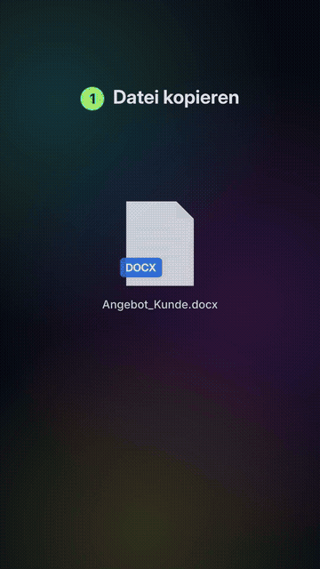
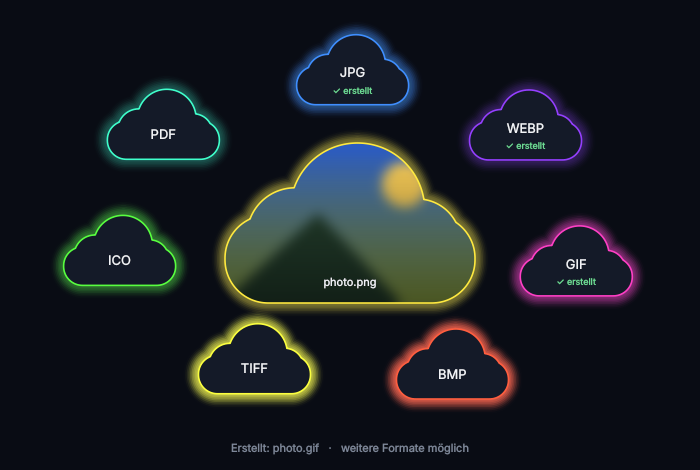

<p align="center">
  
</p>

<h1 align="center">FormatFix</h1>

<p align="center">
  <b>Dateien umwandeln. 100 % lokal. Ohne Cloud.</b><br>
  Datei kopieren, <kbd>Strg</kbd> + <kbd>Alt</kbd> + <kbd>K</kbd> drücken, Format anklicken – fertig.
</p>

<p align="center">
  
</p>

---

## Warum FormatFix?

Online-Konverter laden deine Dateien auf fremde Server – Angebote, Verträge, Fotos, Sprachaufnahmen.
FormatFix macht dasselbe **direkt auf deinem PC**:

- 🔒 **Kein Upload, keine Cloud, kein Tracking** – FormatFix hat keinen Internetzugriff
- ⚡ **Ein Hotkey** statt Websites, Werbung und Wartezeiten
- 🖱️ **Mehrere Formate nacheinander** in einem Rutsch
- 🆓 **Kostenlos**, Quellcode offen einsehbar

<p align="center">
  
</p>

## Was kann umgewandelt werden?

| Von | Nach |
|---|---|
| 🖼️ **Bilder** – PNG, JPG, WEBP, GIF, BMP, TIFF, ICO | alle Bildformate untereinander, PDF |
| 🎬 **Videos** – MP4, MKV, MOV, AVI, WMV, WEBM, FLV, M4V, 3GP, MPG, TS, MTS | MP4, MKV, MOV, AVI, WMV, WEBM, GIF, MP3, WAV |
| 🎵 **Musik** – MP3, WAV, FLAC, OGG, M4A, AAC, WMA | alle Audioformate untereinander, **MIDI** (Notenerkennung) |
| 📄 **PDF** | PNG, JPG (erste Seite), TXT |
| 📝 **Word** – DOCX, DOC, ODT, RTF, TXT | PDF, DOCX, ODT, RTF, TXT, HTML ¹ |
| 📊 **Excel** – XLSX, XLS, ODS, CSV | PDF, XLSX, ODS, CSV, HTML ¹ |
| 📽️ **Präsentationen** – PPTX, PPT, ODP | PDF, PPTX, ODP ¹ |

¹ benötigt das kostenlose [LibreOffice](https://de.libreoffice.org/download/download/)

> **MIDI-Tipp:** Die Notenerkennung klappt am besten mit *einem* Instrument oder *einer* Stimme
> (Klavier, Gitarre, Gesang). Ganze Band-Songs ergeben viele falsche Noten, Schlagzeug wird nicht erkannt.

## Download & Einrichtung

1. Unter **[Releases](../../releases)** die neueste `FormatFix.zip` herunterladen
2. Entpacken (Rechtsklick → „Alle extrahieren“) und den Ordner an einen festen Ort legen
3. `FormatFix.exe` starten – bei der Windows-Warnung „Weitere Informationen“ → „Trotzdem ausführen“
4. Unten rechts erscheint eine bunte Wolke. Rechtsklick → **„Mit Windows starten“** anhaken

**Benutzen:** Datei im Explorer markieren → <kbd>Strg</kbd>+<kbd>C</kbd> → <kbd>Strg</kbd>+<kbd>Alt</kbd>+<kbd>K</kbd> → Format anklicken.
Die neue Datei landet im selben Ordner wie das Original.

Systemvoraussetzung: Windows 10 oder 11 (64 Bit).

## Datenschutz & Sicherheit

- Keine Netzwerkverbindungen, keine Telemetrie, keine Datensammlung
- Der Hotkey wird über die Windows-Funktion `RegisterHotKey` angemeldet – FormatFix liest **keine** anderen Tastatureingaben mit
- Die Zwischenablage wird nur gelesen, wenn du den Hotkey drückst
- Autostart nur für den eigenen Windows-Benutzer, ohne Administratorrechte

Prüf es gern selbst – der komplette Code liegt in diesem Repository.

## Selbst bauen

Voraussetzungen: Windows, Python 3.11+, [ffmpeg](https://www.gyan.dev/ffmpeg/builds/) entpackt unter `C:\ffmpeg\…\bin\ffmpeg.exe`.

```bat
python -m venv .venv
.venv\Scripts\python -m pip install -r requirements.txt
build.bat
```

Ergebnis: `dist\FormatFix\FormatFix.exe` und `dist\FormatFix.zip`.
Zum Ausprobieren ohne Build: `.venv\Scripts\python formatfix.py`

| Datei | Aufgabe |
|---|---|
| `formatfix.py` | Hintergrundprogramm: Tray-Symbol, Hotkey, Autostart |
| `gui.py` | Oberfläche mit den Format-Wolken (Qt / PySide6) |
| `konverter.py` | Die eigentliche Umwandlung (Pillow, ffmpeg, pypdfium2, LibreOffice) |
| `audio2midi.py` | Audio → MIDI auf Basis von Spotifys *Basic Pitch* |
| `build.bat` | Baut die `.exe` und die Weitergabe-ZIP |

## Lizenz

FormatFix steht unter der [MIT-Lizenz](LICENSE).
Mitgelieferte Bestandteile (ffmpeg, Qt, Basic Pitch u. a.) behalten ihre eigenen Lizenzen – siehe [Lizenzen.txt](Lizenzen.txt).
